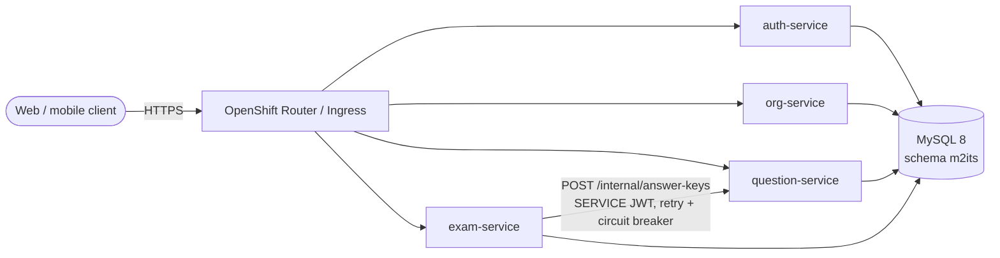

# M2I Online Exam – Spring Boot microservices on OpenShift

The `m2its` online-exam database (MySQL, see the legacy dump) re-implemented as four Spring Boot 3.5 / Java 17
microservices with JPA (Hibernate) ORM, Flyway-managed schema, JWT security, and deployment assets for
Docker, Kubernetes and Red Hat OpenShift (OCP 4.x).

**Deployment and verification guide:** [docs/DEPLOYMENT-GUIDE.md](docs/DEPLOYMENT-GUIDE.md)

## Architecture



| Service | Owns tables (legacy schema) | Responsibilities |
|---|---|---|
| **auth-service** | `admin_info`, `user_info` | Login, JWT issuing, super admins, organisation users, password migration to BCrypt |
| **org-service** | `org_info`, `class_info`, `subject_info`, `chapter_info`, `contact_m2i` | Tenants and the class → subject → chapter hierarchy, public contact form |
| **question-service** | `question_info_v_two`, `answer_info_v_two` | Question bank with options, randomised question papers (answers hidden), answer keys for scoring |
| **exam-service** | `exam_info` | Exam submission, server-side scoring, result history |

Design decisions:

- **One schema, strict table ownership.** The services share the existing `m2its` database so the legacy
  data keeps working without a migration project, but each table is read and written by exactly one service.
  Cross-service data goes over REST. Each service runs its own Flyway history table
  (`flyway_history_<service>`), so the tables can later move to separate databases.
- **Works on the existing dump and on an empty database.** The V1 migrations use `CREATE TABLE IF NOT EXISTS`
  and mirror the legacy DDL; later migrations widen password columns for BCrypt and add missing indexes.
- **Security.** Every service is a stateless OAuth2 resource server (HS256 JWT). Roles map from the legacy labels
  (`Super Admin`, `Admin`, `Data Entry Operator`, `User`). Tenant isolation: non-super-admins only see their own
  organisation. Legacy plain-text passwords are accepted once and immediately re-hashed with BCrypt.
- **Operability.** Actuator on a separate port (8081) for probes and Prometheus, graceful shutdown,
  RFC 7807 error bodies, `X-Request-Id` propagation, ECS JSON logs in the cluster.

## Repository layout

```
common/             shared security, error handling, request-id filter, base entity, shared config (common.yml)
auth-service/       org-service/      question-service/      exam-service/
Dockerfile          one multi-stage UBI image definition for all services (--build-arg SERVICE=...)
docker-compose.yml  MySQL pre-loaded with the legacy dump + all services
k8s/database/       dev/test MySQL StatefulSet (base = OpenShift, kubernetes = plain k8s)
k8s/base/           Deployments, Services, HPAs, PDBs, ConfigMap, NetworkPolicy
k8s/overlays/       kubernetes (Ingress) and openshift (Routes, BuildConfigs, ImageStreams, ServiceMonitor)
scripts/            verify-deployment.sh / .ps1 - end-to-end deployment verification
.github/workflows/  CI/CD: test -> image build, scan, push -> deploy to OpenShift -> verify
```

## Quick start (no Docker, no database)

Requires only Java 17; Maven is fetched by the wrapper.

```bash
./mvnw verify                                   # build + 14 integration tests

# Run one service with an in-memory H2 database:
SPRING_PROFILES_ACTIVE=local BOOTSTRAP_ADMIN_EMAIL=root@local.test BOOTSTRAP_ADMIN_PASSWORD='Root#Pass1' \
  java -jar auth-service/target/auth-service.jar
# Swagger UI: http://localhost:8080/swagger-ui.html
```

Windows PowerShell: use `.\mvnw.cmd verify` and set variables with `$env:NAME = "value"`.

## API overview

| Method & path | Service | Who |
|---|---|---|
| `POST /api/auth/login` | auth | public |
| `GET /api/auth/me`, `PUT /api/auth/me/password` | auth | any user |
| `GET/POST /api/users`, `GET/PUT/DELETE /api/users/{id}` | auth | super admin, org admin (own org) |
| `GET/POST /api/admins` | auth | super admin |
| `GET /api/roles` | auth | any user |
| `GET/POST /api/orgs`, `GET/PUT/DELETE /api/orgs/{id}` | org | read: members; write: super admin (PUT also org admin) |
| `/api/classes`, `/api/subjects`, `/api/chapters` (+ `/{id}`) | org | read: members; write: admins |
| `POST /api/contact` / `GET /api/contact` | org | public / super admin |
| `/api/questions` (+ `/{id}`) | question | super admin, admin, data entry operator |
| `GET /api/question-papers?subjectId=&chapterId=&limit=` | question | any member (no correct answers) |
| `POST /api/exams/submissions` | exam | organisation members |
| `GET /api/exams/sessions`, `GET /api/exams/sessions/{id}` | exam | own attempts; admins: organisation |

Full contracts: Swagger UI at `/swagger-ui.html` on each service.
